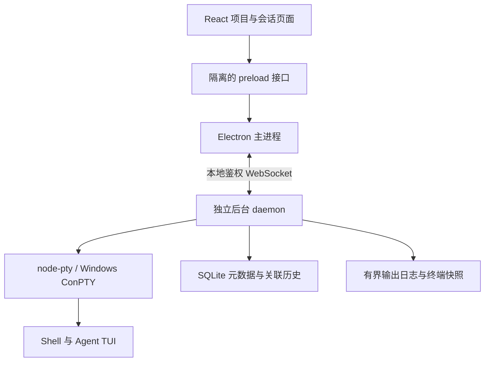

# AgentBerth · 泊栈

按项目组织的 Agent 会话工作台。一个目录可以有多个会话；终端由独立后台进程持有，关闭窗口或退出工作台后，重新打开可接回同一运行实例。

第一版以 **Windows 10 1809+ / Windows 11** 为主要目标，提供 Electron + React + TypeScript 桌面应用，并在 Linux 上验证 PTY 核心。

## 当前能力

- 添加本机项目目录，从指定目录启动终端；同一路径自动去重。
- 每个项目可创建多个命名会话，支持 Codex、Claude Code、普通终端和自定义单行启动命令。
- 独立 daemon 管理 PTY；切换项目、收起终端、关闭窗口和退出工作台都不会停止后台终端。
- 重新打开工作台，接回原有 PID、输入输出和最近终端画面。
- 每次启动保留独立运行记录；显式停止当前终端，清理其进程树。
- 为 Codex / Claude Code 会话手动关联原生 JSONL 记录，校验项目目录，查看用户与助手文本，刷新记录并按原生 ID 恢复会话。
- SQLite 持久化项目、会话和运行元数据；有界输出日志和后台终端数量。

## 开发环境与启动

需要 Node.js **24+**、npm，以及本机已安装和登录的 Agent CLI。项目不会替你登录 Agent 或修改其权限设置。

Windows 首次构建 `node-pty` 需要：

1. Python 3。
2. Visual Studio 2022 Build Tools 的“使用 C++ 的桌面开发”工作负载、Windows SDK，以及相应 MSVC Spectre 库。

Linux 需要 `python3`、`make`、C++ 编译器、桌面环境和 Electron 所需系统库。自动桌面测试需 `xvfb`。

```powershell
git clone https://github.com/Tan90degrees/AgentBerth.git
cd AgentBerth
# 首个版本尚在开发分支时：
git switch feat/session-workbench
npm ci
npm run dev
```

`npm run dev` 会先编译桌面与后台代码，再启动 Vite 和 Electron。页面修改自动更新；main、preload、daemon 修改后需要重新启动相关进程。后台使用 Electron 自带的 Node 运行时，与原生模块 ABI 保持一致，不依赖用户另装的 Node 来运行打包应用。

应用关闭按钮默认隐藏到托盘。托盘“退出工作台（终端继续运行）”会退出 Electron 工作台；独立 daemon 和 PTY 继续运行。再次启动应用即可接回。

## 第一次使用

1. 点击 **添加项目目录**，选择例如 `D:\Projects\OmniOCR`。
2. 点击 **新建会话**，填写用途，例如“调度优化”和“文档整理”。
3. 选择 Agent 类型后点击 **创建并启动**。默认调用 `codex` / `claude`，普通终端不运行额外命令；自定义类型运行你填写的单行命令。
4. 会话都从项目目录启动。切换、收起终端或关闭窗口，任务继续运行；回来后接回。
5. 需要真正结束任务时，点击 **停止终端**。它会强制结束终端及其进程树，未完成的任务会中断。

状态“运行中”指 Shell / 终端实例仍在运行，不代表 Agent 正在生成。Agent 退出到 Shell 后，终端仍可继续使用。

## 对话历史与恢复

终端画面、运行输出和 Agent 对话是三种不同的数据。运行输出包含 ANSI 控制序列和 TUI 重绘，不能当作结构化对话。

在 Codex 或 Claude Code 会话的 **对话历史** 中点击 **关联 JSONL**，选择其原生记录文件：

- Codex 常见位置：`~/.codex/sessions/` 下的 `rollout-*.jsonl`。读取 `session_meta`、`response_item`；只有事件记录的文件使用 `event_msg` 文本。
- Claude Code 常见位置：`~/.claude/projects/<project>/<session-id>.jsonl`。读取原生会话 ID、工作目录与用户/助手文本。

路径受 Agent 配置和版本影响，可以通过文件选择器手动指定。只接受当前项目目录的记录，不会改写原始文件。当前文本视图不展示工具调用、图片、推理过程和分支结构；只读最近最多 1000 条消息、512 KiB 文本。文件最大 16 MiB；压缩 `.jsonl.zst` 和超过限制的文件暂不支持。

记录关联后，可点击 **刷新记录** 读取追加内容。终端已结束时，点击 **恢复原生会话**，分别调用 `codex resume <id>` 或 `claude --resume <id>`。这是新进程加载原生历史；后台仍存活时的“接回终端”则连接原有进程。

第一版管理从本工作台启动的终端。已有 Windows Terminal 中的进程不能直接迁入，需关联历史并从工作台恢复。Windows 原生 CLI 已纳入设计，WSL、SSH、远端 daemon 和自动扫描历史留待后续版本。

## 数据、生命周期与限制

- 默认数据目录：Electron `userData/data`（Windows 通常为 `%APPDATA%\agentberth\data`）。实际目录取决于 Electron 平台规则。
- 可在启动时指定绝对路径 `AGENTBERTH_DATA_DIR`，用于隔离开发或测试数据。
- `berth.sqlite` 保存元数据与关联历史；`logs/` 保存运行输出；`runtime.json` 保存本地连接信息；`daemon.lock` 控制单后台实例。
- `runtime.json` 含本地鉴权凭据，不能提交、上传或共享。项目目录里不会创建状态文件。
- 默认最多 16 个同时运行的终端、200 个项目、2000 个未归档会话。只挂载当前显示的终端组件。
- 每次运行保留最近最多 4 × 1 MiB 原始输出；后台滚屏 2000 行；重连快照保留最近 200 行及当前屏幕。
- 启动新运行时清理较旧非活动日志，目标总量 128 MiB；活动运行保留各自配额，因此总量可能暂时超过此值。
- 重启电脑或 daemon 意外退出后，运行记录标记为“曾中断”，不会自动执行命令。可重新启动或由 Agent 原生能力恢复历史。
- 显式停止在 Windows 使用系统进程树终止，在 Unix 枚举子进程和作业组；缺少 `ps` 的精简环境退回 Shell hangup。自行脱离进程树的服务不属于可保证清理范围。

完整退出后台前，请先停止所有任务，然后向 `runtime.json` 所记录的 daemon PID 发送终止信号。第一版没有“退出全部后台”按钮，以免误操作中断所有会话。升级应用前应先停止后台，避免旧 daemon 与新代码混用。

## 验证与打包

```powershell
npm run check          # TypeScript + 真实 PTY 测试 + 生产构建
npm run test:desktop   # Playwright 驱动真实 Electron 窗口
npm run dist:win       # Windows 本机生成 NSIS x64 安装包
```

Linux 无显示器环境：

```bash
xvfb-run -a npm run test:desktop
```

测试使用临时项目与数据目录，不运行真实 Agent，不访问用户真实对话。真实 PTY 测试覆盖无 UI 时持续输出、同 PID 恢复、会话隔离、并发启动、鉴权、进程树清理、持久化与日志轮转。桌面测试覆盖项目创建、终端输入、收起/接回、原生窗口关闭、整个工作台退出后重新打开和停止任务。

GitHub Actions 配置 Windows / Linux 检查和桌面测试；通过后生成 Windows 安装包 artifact。第一版安装包尚未进行代码签名。

## 架构



daemon 拥有终端，工作台是可断开的客户端。后台持续消费输出；慢客户端断开后通过快照重连。终端输入绑定运行 ID，避免重启时把旧视图的输入写入新的进程。

## 后续方向

- 原生历史发现与目录匹配；适配更多 Agent 的会话存储。
- 分屏、多终端可见布局与会话归档恢复。
- 更准确的忙碌/等待输入状态（通过 Agent 原生事件，而非猜测屏幕文本）。
- WSL / SSH 与远程会话宿主。
- 安全的后台管理和升级流程。

## 许可证

Apache-2.0，沿用仓库原有许可证。
