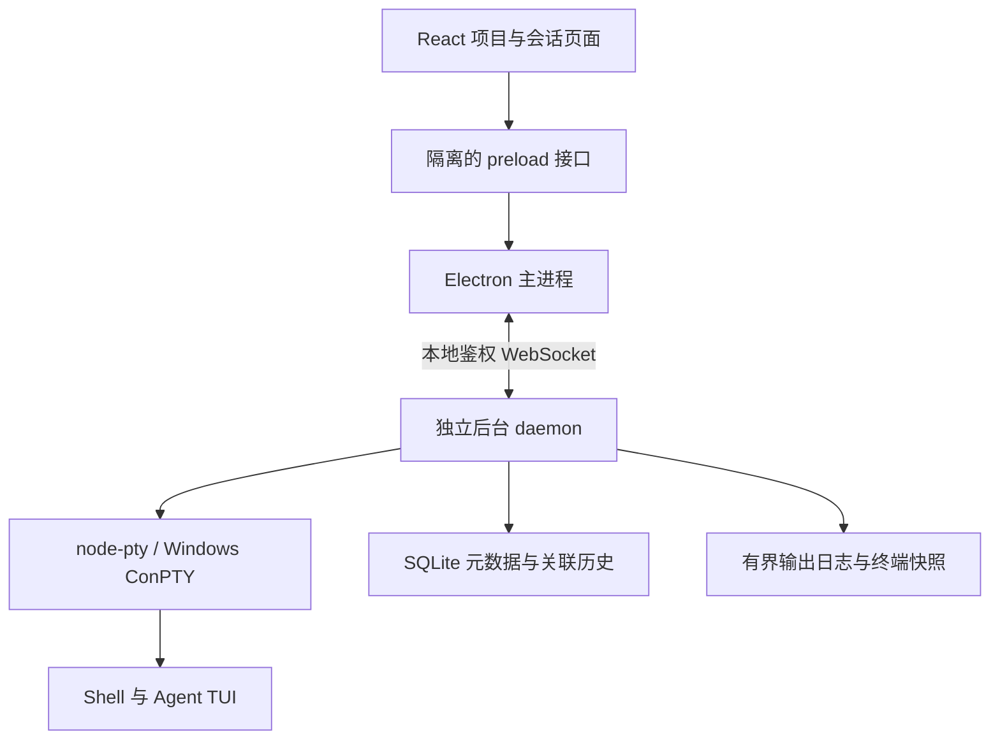

# AgentBerth · 泊栈

按项目组织的本地开发工作台，汇集终端、Agent、文件与原生对话历史。一个目录可以有多个会话；终端由独立后台进程持有，关闭主窗口后仍继续运行，重新打开可接回同一运行实例；从托盘退出会停止全部终端及后台进程。

第一版以 **Windows 10 1809+ / Windows 11** 为主要目标，提供 Electron + React + TypeScript 桌面应用，并在 Linux 上验证 PTY 核心。

## 当前能力

- 预览支持 193 种内置语法，覆盖 JSON / YAML / TOML、常见编程语言与配置类型；可手动选择语言或自动识别。源码与 Markdown 代码块均在 Worker 中高亮。
- 全局设置的“文件预览”可调整字号（10–28 px）、选择或自定义本机字体，自动保存，独立于终端设置。
- 终端路径只在按住 Ctrl（macOS 也可 ⌘）时出现下划线与点击手势；普通拖选、双击和 TUI 鼠标操作保留原行为。

- 左侧切换“会话 / 文件 / Git”，主区切换“终端 / 历史 / 预览”；文件预览可独立于会话使用，切换内容页保留终端实例。
- Ctrl（macOS ⌘）点击终端中的路径，直接预览文件或定位目录；模糊名称多个匹配可选择，支持 `:行:列`，也可在左侧点击“查找文件或目录”。
- 项目名称恢复为 AgentBerth · 泊栈；兼容 v0.11.0 的安装升级，沿用原有数据目录与应用标识。

- ChatGPT 风格的中性界面，默认深色，支持浅色、深色与跟随系统；侧栏底部一键切换，终端同步换色且保持运行。[外观设置](docs/appearance.md)。

- 顶部信息采用紧凑布局，可折叠详情并记住状态；折叠后保留会话状态和历史标签，管理操作统一放在左侧右键／⋯ 菜单。
- 左侧 Git 视图支持逐文件或多选暂存、取消暂存、提交已暂存内容，主区可查看未暂存/已暂存差异。
- 紧凑 Git 分支入口、工作区状态、获取远端、快进拉取、推送/发布、同步和本地分支切换，参见 [Git 使用说明](docs/git.md)。
- **资源占用**：会话、项目与工作台三级 CPU/内存紧凑显示，包含子进程，前台轻量采样。[统计口径](docs/resources.md)。
- 原生历史可保留多条会话 ID，支持搜索、分页、预览、关联与解除；运行中可修改关联，插件可用可选 list 接口分页发现会话。
- 自定义 Agent 支持运行中“更新插件”：导入新版配置/脚本即热更新，校验失败保留旧版，不重启工作台和终端。
- 保存多种自定义 Agent 类型并设为默认；导入一个 JSON 配置或自描述脚本，只需设置名称；命令与能力自动读取，脚本使用软件自带 Node 运行时。可导出开发套件和复制完整 Agent 开发指令，参见 [使用说明](docs/agent-plugins.md) 与 [Agent 开发指南](docs/AGENT_PLUGIN_DEVELOPMENT.md)。

- 单侧栏按项目展开/收拢会话，搜索覆盖项目与会话；可拖拽调宽，宽度与收拢状态自动保存，方向键微调、双击恢复默认宽度。

- 项目和会话的管理统一放在左侧右键／⋯ 菜单：新建、重命名、配置、复制、删除、启动与停止；右侧只展示内容与状态。支持 Shift+F10、方向键与 Esc；操作未选中的条目不会切换当前终端。项目按名称/目录搜索，会话支持名称、Agent、命令、原生 ID 搜索与状态/Agent 筛选。
- 每个项目可创建多个命名会话，支持 Codex、Claude Code、OpenCode、普通终端和自定义单行启动命令；可以先创建，稍后启动。
- 设置页面持久化默认终端、默认 Agent 和终端字号；每个会话可以覆盖默认终端。
- 全局快速切换与键盘操作，记住每个项目上次选择的会话；多关键词、路径分隔符兼容搜索。
- 设置草稿跨页面与工作台重开保留，表单关闭前保护未保存内容；会话配置可复制，路径和原生 ID 可一键复制。
- 目录移动或终端程序缺失时保留失败记录，提供修改配置与重新启动入口。
- 独立 daemon 管理 PTY；切换项目、收起终端、关闭窗口都不会停止后台终端；托盘「退出 AgentBerth（停止全部终端）」会完整退出。
- 重新打开工作台，接回原有 PID、输入输出和最近终端画面。
- 终端优先使用 WebGL 绘制连续块字符与框线，改善 TUI 内滚动条断线和字符溢出；图形上下文不可用或丢失时原位降级。
- 终端缩放和输出共享顺序边界，前端与后台按相同尺寸解析；连续拖动合并中间尺寸，避免请求积压。兼容旧后台的缩放方式；更新后台后启用同步缩放。
- 普通 Shell 会话保留独立运行记录和输出；Agent TUI 不录制屏幕、不显示运行记录，只保留当前状态和原生对话历史。显式停止清理进程树，结束后可重新启动；终端滚动条有独立预留空间。
- 为 Codex / Claude Code 关联原生 JSONL，为 OpenCode 关联导出的 JSON；校验目录、查看文本、刷新记录和恢复原生会话，也可直接关联原生 ID。
- 终端与只读运行输出提供选中复制、查找、匹配前后跳转和回到底部；显式粘贴保留 TUI 的括号粘贴模式，大段中文输入按序分段传输。按住 Ctrl 点击终端 HTTP / HTTPS 链接在默认浏览器打开。
- SQLite 持久化项目、会话和运行元数据；有界输出日志和后台终端数量。

## 下载 Windows 软件包

打开 [最新正式版本](https://github.com/Tan90degrees/AgentBerth/releases/latest)，直接下载安装程序或 ZIP。发布页还提供 SHA-256 校验文件与构建信息，无需从 Actions 的临时产物中查找。

开发分支和 PR 的验证包仍可在 [GitHub Actions](https://github.com/Tan90degrees/AgentBerth/actions) 对应运行的 **Artifacts → AgentBerth-Windows-x64** 中下载。主分支全部检查通过后，由发布任务校验文件、上传附件并公开对应版本；版本已发布时跳过，不覆盖旧包。

发布附件（Actions 验证包解压后也包含同样文件）：


| 文件 | 使用方式 |
|---|---|
| `AgentBerth-0.12.0-windows-x64-setup.exe` | 双击安装，选择安装目录后从快捷方式启动 |
| `AgentBerth-0.12.0-windows-x64.zip` | 完整解压到固定目录，运行其中的 `AgentBerth.exe` |
| `SHA256SUMS.txt` | 安装包与 ZIP 的 SHA-256 校验值 |
| `build-info.json` | 版本、提交、Actions 运行链接与打包后测试结果 |

软件包自带 Electron、Node 运行时和 `node-pty`，使用时无需安装 Node.js、npm 或 C++ 编译工具。Codex / Claude Code / OpenCode 需在本机单独安装、配置，并能从所选 Shell 的 PATH 调用。ZIP 版需保留整个解压目录；daemon 使用该目录中的运行时，后台任务运行期间不要移动或删除它。升级前停止全部后台任务；安装新版后通过提示或 **设置 → 更新后台** 加载新后台，0.1 数据会自动迁移并保留。

第一版软件包没有代码签名，Windows 可能显示“未知发布者”。正常包应对应成功的 Windows 打包任务且 `build-info.json` 中 `packagedSmoke` 为 `success`；若测试失败，构建产物会保留供排查，但不代表已验证可用。

## 开发环境与启动

需要 Node.js **24+**、npm，以及本机已安装和登录的 Agent CLI。项目不会替你登录 Agent 或修改其权限设置。

Windows 首次构建 `node-pty` 需要：

1. Python 3。
2. Visual Studio 2022 Build Tools 的“使用 C++ 的桌面开发”工作负载、Windows SDK，以及相应 MSVC Spectre 库。

Linux 需要 `python3`、`make`、C++ 编译器、桌面环境和 Electron 所需系统库。自动桌面测试需 `xvfb`。

```powershell
git clone https://github.com/Tan90degrees/AgentBerth.git
cd AgentBerth
npm ci
npm run dev
```

`npm ci` 的 postinstall 会先安装 Electron 二进制，再为其编译 `node-pty`。安装过程失败或被 `--ignore-scripts` 跳过后，可运行 `npm run setup` 单独完成安装。脚本使用当前锁定的 Electron 版本、官方安装器与内置校验和，沿用已有下载缓存，不需要重装全部依赖。

`npm run dev` 会先检查本机 Electron 二进制是否完整，再编译桌面与后台代码，启动 Vite 和 Electron。缺少二进制时立即提示 `npm run setup`，不会在加载入口时隐式下载。页面修改自动更新；main、preload、daemon 修改后需要重新启动相关进程。后台使用 Electron 自带的 Node 运行时，与原生模块 ABI 保持一致，不依赖用户另装的 Node 来运行打包应用。

应用关闭按钮默认隐藏到托盘，任务继续运行。托盘「退出 AgentBerth（停止全部终端）」先清理所有终端及其子进程，再结束 daemon 和应用。退出后再次打开保留项目、会话、设置和运行记录，终端处于已停止状态，不会自动重新执行命令。

### Electron 下载失败

`Downloading Electron binary...` 后的 `TypeError: fetch failed` 表示二进制下载请求失败，应用尚未启动。常见原因是无法访问 GitHub Release 下载源、未配置 Node 的 HTTP 代理或证书链问题；仅凭这条报错无法判断具体原因。npm 的包 registry 与 Electron 的二进制下载源独立，修改 registry 不会同时改变 Electron 下载地址。

在项目根目录的 **PowerShell** 中任选一种方式，然后执行 `npm run setup`：

```powershell
# 方式一：使用 Electron 官方文档列出的镜像
$env:ELECTRON_MIRROR = "https://npmmirror.com/mirrors/electron/"
$env:ELECTRON_CUSTOM_DIR = "{{ version }}"
npm run setup
if ($LASTEXITCODE -eq 0) { npm run dev }
```

```powershell
# 方式二：已有 HTTP 代理；7890 必须换成你的实际 HTTP/混合代理端口
$env:HTTPS_PROXY = "http://127.0.0.1:7890"
$env:HTTP_PROXY = $env:HTTPS_PROXY
$env:NODE_USE_ENV_PROXY = "1"
npm run setup
if ($LASTEXITCODE -eq 0) { npm run dev }
```

如果此前设置过镜像，改用官方源加代理时，先移除当前终端的镜像配置：

```powershell
Remove-Item Env:ELECTRON_MIRROR, Env:ELECTRON_CUSTOM_DIR -ErrorAction SilentlyContinue
```

上述配置仅作用于当前 PowerShell。`setup` 也会将已有 npm HTTP(S) 代理选项传给安装子进程，并在未显式设置 `NODE_USE_ENV_PROXY` 时启用 Node 24 的环境代理支持。不会自动切换下载源或修改用户全局 npm 配置。

镜像可访问性及所需版本是否已同步取决于镜像服务。遇到 HTTP 404，请使用已配置代理的官方源。Electron 二进制镜像也不替代原生模块编译所需的 Electron headers 下载源。

旧版本没有 `setup` 命令时，可先配置上述环境变量，再执行本地安装器：

```powershell
node .\node_modules\electron\install.js
if ($LASTEXITCODE -eq 0) { npm run dev }
```

如果仍失败，可设置 `$env:DEBUG = "@electron/get*"` 后重试安装器，查看下载目标与缓存信息；代理/网络问题需检查实际错误，证书问题需配置可信 CA。无需删除整个 `node_modules`。

参考：[Electron 安装与镜像配置](https://www.electronjs.org/docs/latest/tutorial/installation)、[Node.js 环境代理支持](https://nodejs.org/learn/http/enterprise-network-configuration)。

## 第一次使用

1. 点击侧栏“项目与会话”旁的 **＋**，或欢迎页的 **添加第一个项目**，选择例如 `D:\Projects\OmniOCR`。
2. 右键左侧项目或点击 **⋯ → 新建会话**，可填写用途，例如“调度优化”，也可留空自动命名。
3. 选择 Agent 类型后点击 **创建并启动**。分别调用 `codex` / `claude` / `opencode`，普通终端不运行额外命令；自定义类型运行填写的单行命令。取消“创建后立即启动”，可仅保存会话。
4. 会话都从项目目录启动。切换、收起终端或关闭窗口，任务继续运行；回来后接回。
5. 需要真正结束任务时，右键会话选择 **停止终端** 并确认。它会强制结束终端及其进程树，未完成的任务会中断。

状态“运行中”指 Shell / 终端实例仍在运行，不代表 Agent 正在生成。Agent 退出到 Shell 后，终端仍可继续使用。

## 项目、会话与设置

右键左侧项目或会话（或点击 **⋯**）打开管理菜单，提供新建、重命名、编辑、复制、删除及会话启动／停止和原生恢复。运行中可以修改名称；更换目录、Agent、启动命令和会话终端之前需要停止相关终端。修改项目目录或 Agent 类型会清除原生对话关联，已保留的运行记录仍可查看。

删除会话会清理它的工作台元数据、导入的对话副本和运行日志；删除项目会同时清理其全部会话。删除需要确认且无法撤销，磁盘项目文件和 Agent 原生记录会保留。后台会再次检查状态，防止在终端刚启动时误删。

左侧 **设置** 可以选择系统默认、Windows PowerShell、PowerShell 7、CMD、Bash / Git Bash 或自定义终端。自定义终端指定可执行文件（Windows 为 `.exe`）及每行一个的参数；程序路径不加引号，路径中的空格会完整保留。保存时检查默认终端是否可用。PowerShell 自定义示例参数为 `-NoLogo`、`-NoExit`；Git Bash 可指定 `bash.exe` 与 `--login`、`-i`。

默认终端决定工作台内运行的 Shell；默认 Agent 用于新建会话表单。选择「自定义 Agent」后可填写默认启动命令，保存后填入新建会话；修改默认值不会改变已有会话的命令。设置改变后用于下次启动，运行中的终端保持原 PID。会话的 **会话终端** 默认为“跟随默认终端”，也可以单独指定。字号范围为 10–24。PowerShell 7 从 PATH、常见 MSI / Scoop / .NET / WinGet / Store 安装位置及 Windows 当前持久化 PATH 自动发现；便携安装或指定版本可以在 PowerShell 7 的程序栏覆盖完整路径。

设置未保存时保留为当前设备上的草稿。切换页面或重开工作台后继续编辑，点击 **保存设置** 才会应用，**取消修改** 恢复后台设置。项目、会话和原生 ID 表单在关闭、取消或按 Escape 时会提示保留/放弃未保存修改；提交期间暂时禁止修改表单。

点击 **复制会话** 复制名称、Agent、命令和终端配置，默认只创建而不启动，不复制运行进程和原生对话关联。右键项目选择 **复制项目路径**；对话记录旁的 **复制 ID** 可直接复制到剪贴板。

## 快速切换与快捷键

点击侧栏 **快速切换**，或按 `Ctrl+Shift+P`，搜索全部项目、会话、目录、Agent 和原生 ID，以及创建/设置入口。用上下方向键选择，Enter 打开，Escape 关闭；切换后恢复终端或表单焦点。搜索支持多个关键词，Windows 路径的 `/` 与 `\\` 可以互换。

| 快捷键 | 操作 |
|---|---|
| `Ctrl+Shift+P` | 打开/关闭快速切换 |
| `Ctrl+Shift+N` | 在当前项目新建会话 |
| `Ctrl+Shift+O` | 添加项目目录 |
| `Ctrl+,` | 打开设置 |
| `Ctrl+Tab` / `Ctrl+Shift+Tab` | 在当前项目的筛选结果中切换到下一个 / 上一个会话 |
| `Ctrl+Shift+C` | 复制终端选中文字，普通 `Ctrl+C` 仍传给终端 |
| `Ctrl+Shift+V` | 显式粘贴剪贴板文字到运行中的终端 |
| `Ctrl+Shift+F` | 查找当前终端或只读输出 |
| `Enter` / `Shift+Enter`（查找框内） | 下一个 / 上一个匹配 |
| `Escape`（查找框内） | 关闭查找并回到终端 |

终端工具栏也提供复制选中、粘贴、查找和到底部入口。后台、实时终端和只读输出统一采用 Unicode 11 字符宽度，避免部分 emoji 的换行和选区错位。查找框沿用工具栏空间，打开或关闭不会挤压终端或触发重新排版。查找范围为当前视图保留的输出；较旧内容可在运行记录中打开本次只读输出后查找。复制粘贴只在主动点击或使用快捷键时读取剪贴板，每次粘贴最多 65536 个字符。快捷切换不会停止后台任务，在表单和快速切换弹窗中暂停，避免丢失输入。

每个项目独立记住最后选中的会话。搜索或筛选隐藏了当前会话时，会显示提示，终端仍可继续使用；点击 **清除筛选** 返回完整列表。

项目目录移动、终端程序丢失或 PTY 启动失败时，终端页显示明确错误。右键项目或会话修改配置后重新启动；普通 Shell 的运行记录保留失败信息，Agent TUI 仅保留当前生命周期状态和原生对话历史。Agent 进程在已启动的 Shell 内报告的命令/登录错误仍显示在终端输出中。

## 对话历史与恢复

终端实时画面、普通 Shell 的运行输出和 Agent 原生对话是三种不同的数据。普通 Shell 的运行记录可逐条删除或清除全部已结束记录，同时清理输出日志并保留运行中的终端。仅普通 Shell 保留输出记录；Codex、Claude Code、OpenCode 和自定义 Agent 不保存 TUI 重绘，也不提供“运行记录”或结束后的输出查看。原生对话由内置读取器或插件读取。

在 Codex 或 Claude Code 会话的 **对话历史** 中点击 **关联 JSONL**，选择其原生记录文件：

- Codex 常见位置：`~/.codex/sessions/` 下的 `rollout-*.jsonl`。读取 `session_meta`、`response_item`；只有事件记录的文件使用 `event_msg` 文本。
- Claude Code 常见位置：`~/.claude/projects/<project>/<session-id>.jsonl`。读取原生会话 ID、工作目录与用户/助手文本。

OpenCode 会话在项目目录中执行 `opencode export <sessionID> > session.json`，在工作台点击 **关联 JSON**。读取官方导出结构 `info` 与 `messages[].info/parts`，支持 UTF-8 和 Windows PowerShell 重定向产生的 UTF-16LE 文件。也可以点击 **关联会话 ID**，填写此项目本机已有的原生 ID；这只建立恢复入口，不自动读取对话文本。CLI 用法见 [OpenCode 官方文档](https://opencode.ai/docs/cli/)。

路径受 Agent 配置和版本影响，可以通过文件选择器手动指定。只接受当前项目目录的记录，不会改写原始文件。当前文本视图不展示工具调用、图片、推理过程和分支结构；只读最近最多 1000 条消息、512 KiB 文本。文件最大 16 MiB；压缩 `.jsonl.zst` 和超过限制的文件暂不支持。

记录关联后，可点击 **刷新记录** 重新读取文件（OpenCode 导出快照更新后需要再次导出）。终端已结束时右键会话选择 **恢复原生会话**，分别调用 `codex resume <id>`、`claude --resume <id>` 或 `opencode --session <id>`。这是新进程加载原生历史；后台仍存活时的“接回终端”连接原有进程。手动关联 ID 会覆盖已有导入关联，需要时可重新导入文本。

第一版管理从本工作台启动的终端。已有 Windows Terminal 中的进程不能直接迁入，需关联历史并从工作台恢复。Windows 原生 CLI 已纳入设计，远程 SSH 终端见下文；WSL、远端 daemon 和自动扫描历史留待后续版本。

## 数据、生命周期与限制

- 默认数据目录：Electron `userData/data`（Windows 通常为 `%APPDATA%\agentberth\data`）。实际目录取决于 Electron 平台规则。
- 可在启动时指定绝对路径 `AGENTBERTH_DATA_DIR`，用于隔离开发或测试数据。
- `berth.sqlite` 保存元数据与关联历史；`logs/` 保存运行输出；`runtime.json` 保存本地连接信息；`daemon.lock` 控制单后台实例。
- `runtime.json` 含本地鉴权凭据，不能提交、上传或共享。项目目录里不会创建状态文件。
- 默认最多 16 个同时运行的终端、200 个项目、2000 个未归档会话。只挂载当前显示的终端组件。
- 每次普通 Shell 运行保留最近最多 4 × 1 MiB 原始输出。各运行中的终端在内存中保留 2000 行滚屏，重连快照保留最近 200 行及当前屏幕；Agent TUI 不写输出日志或结束屏幕。
- 启动新运行时清理较旧非活动日志，目标总量 128 MiB；活动运行保留各自配额，因此总量可能暂时超过此值。
- 重启电脑或 daemon 意外退出后，运行记录标记为“曾中断”，不会自动执行命令。可重新启动或由 Agent 原生能力恢复历史。
- 显式停止在 Windows 使用系统进程树终止，在 Unix 枚举子进程和作业组；缺少 `ps` 的精简环境退回 Shell hangup。自行脱离进程树的服务不属于可保证清理范围。

安装新版后，仍存活的旧后台可以接回和停止已有终端，页面会提示更新后台。停止全部终端后点击 **更新后台** 并确认：新后台会加载当前版本并迁移数据库；不会自动终止运行中的任务。后台再次检查启动中的终端和未完成操作，保证更新时处于空闲状态。

## 版本、诊断与支持

在 **设置 → 关于与支持** 查看应用版本、运行环境和后台 API，或使用 **使用说明／反馈问题**。**复制诊断信息** 只复制版本、系统、连接状态和运行终端数，不包含项目路径、命令、会话内容或本地鉴权凭据。**打开数据目录** 用于查看本机数据与日志；不要在问题反馈中上传 `runtime.json`。

应用、安装程序、快捷方式、任务栏和托盘使用统一的薄荷绿 B／终端图标。图标来源与尺寸转换方法见 [assets/README.md](assets/README.md)。

项目目录树、Git 忽略灰显、代码及 Markdown 预览见 [文件浏览与预览](docs/files.md)。

当前版本范围与已知限制见 [v0.9.0 功能说明](docs/releases/v0.9.0.md) 和 [v0.9.1 安装修复](docs/releases/v0.9.1.md)。维护者的发布步骤见 [发布流程](docs/releasing.md)。

## 验证与打包

```powershell
npm run check          # TypeScript + 真实 PTY 测试 + 生产构建
npm run test:desktop   # Playwright 驱动真实 Electron 窗口
npm run dist:win       # Windows 本机生成 NSIS x64 安装包与 ZIP
npm run test:packaged  # Windows 测试 release/win-unpacked/AgentBerth.exe
```

Linux 无显示器环境：

```bash
xvfb-run -a npm run test:desktop
```

测试使用临时项目与数据目录，不运行真实 Agent，不访问用户真实对话。真实 PTY 测试覆盖同 PID 恢复、隔离、并发、进程树清理、增删改保护、设置持久化、0.1 数据迁移和后台升级；OpenCode 用 CLI 替身验证准确的启动/恢复参数。源码版与打包版桌面测试覆盖项目/会话管理、搜索筛选、设置保存、终端选择、原生文件选择 IPC、OpenCode ID/导出关联，以及主窗口关闭继续运行、完整退出后的进程清理、树形侧栏收拢与宽度持久化，以及后台更新。

GitHub Actions 配置 Windows / Linux 检查和桌面测试；独立 Windows 打包任务执行类型检查、安装脚本测试、生产构建与打包后的真实终端测试，再上传安装包、ZIP 和校验值。第一版安装包尚未进行代码签名。

## 架构



daemon 拥有终端，工作台是可断开的客户端。后台合并短时间内的输出后按会话策略写日志与传输，保留输出顺序和快照序号；窗口隐藏时暂停向界面转发输出，重新显示时接回快照。列表批量读取最新运行记录；侧栏拖拽按动画帧更新布局。后台持续消费输出；慢客户端断开后通过快照重连。终端输入绑定运行 ID，避免重启时把旧视图的输入写入新的进程。

## 后续方向

- 原生历史发现与目录匹配；适配更多 Agent 的会话存储。
- 分屏、多终端可见布局与会话归档恢复。
- 更准确的忙碌/等待输入状态（通过 Agent 原生事件，而非猜测屏幕文本）。
- WSL / SSH 与远程会话宿主。
- 安全的后台管理和升级流程。

## 许可证

Apache-2.0，沿用仓库原有许可证。

## 可观察的远程终端与 MCP

新建会话时选择“远程 SSH”，沿用现有 OpenSSH 主机别名；远端只需 SSH 服务和系统已有的登录 Shell，无需安装任何额外程序。设置中复制 MCP 配置，在终端点击“交给 Agent”，即可实时观看同一终端的真实操作并随时接管。主窗口关闭、MCP 超时或断开时，本机后台保持 SSH；SSH 链路真正中断后原任务结果未知，手动重新连接会建立新 Shell。步骤可折叠和翻页。

详见 [使用与边界说明](docs/remote-terminals.md) 和 [提供给 Agent 的操作说明](docs/remote-terminal-agent.md)。
